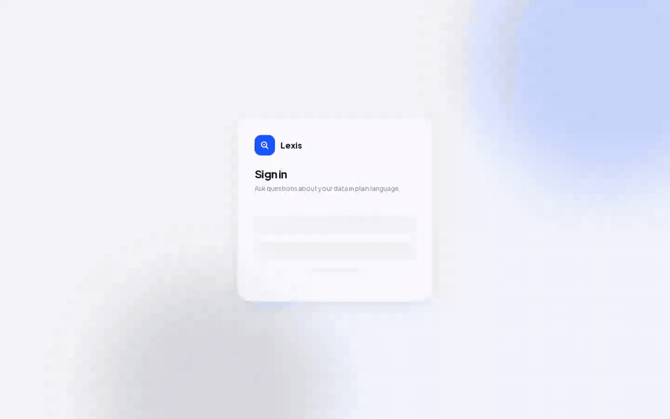
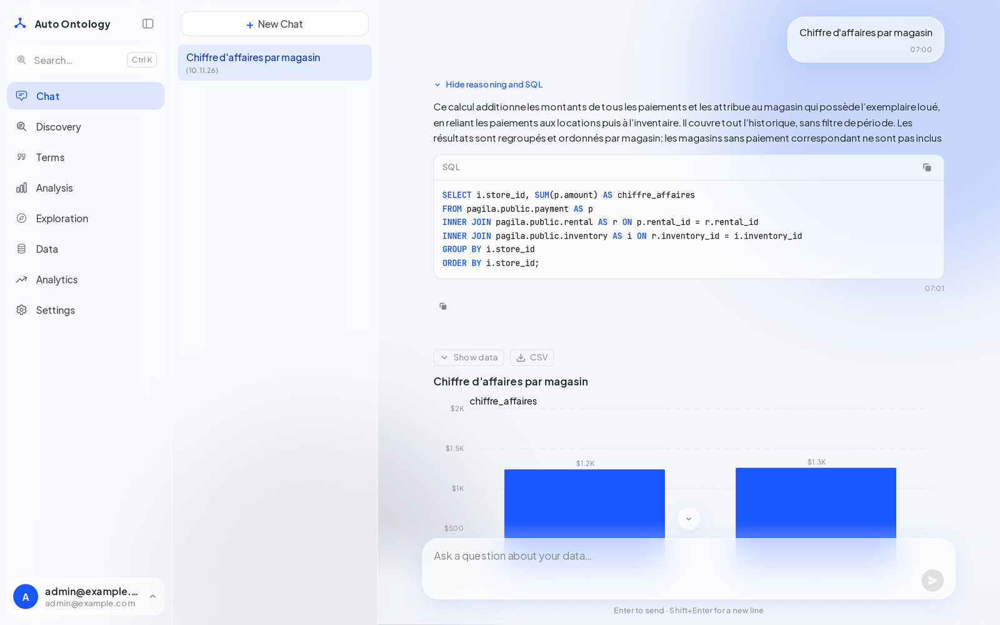
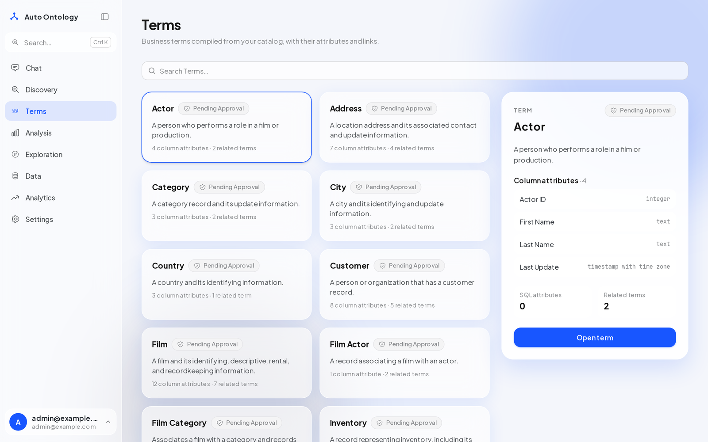
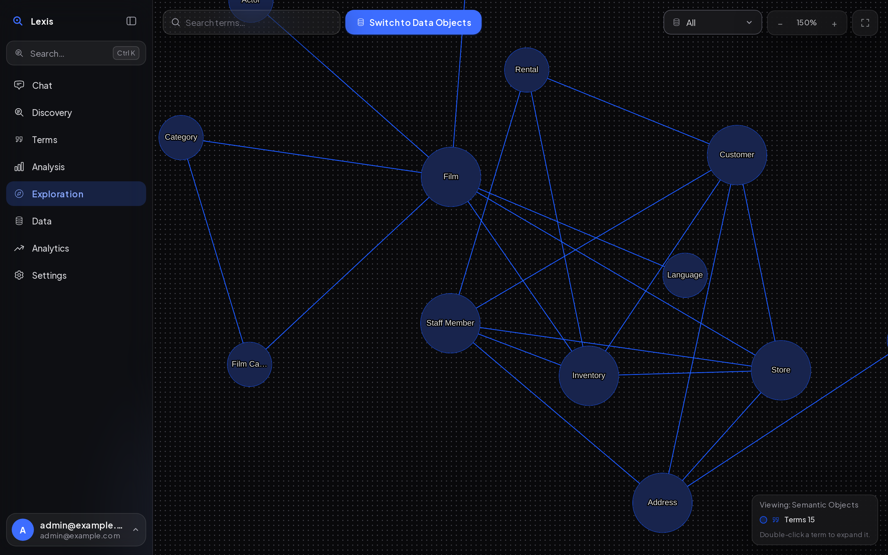
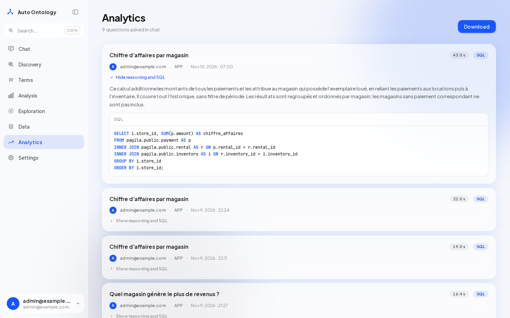
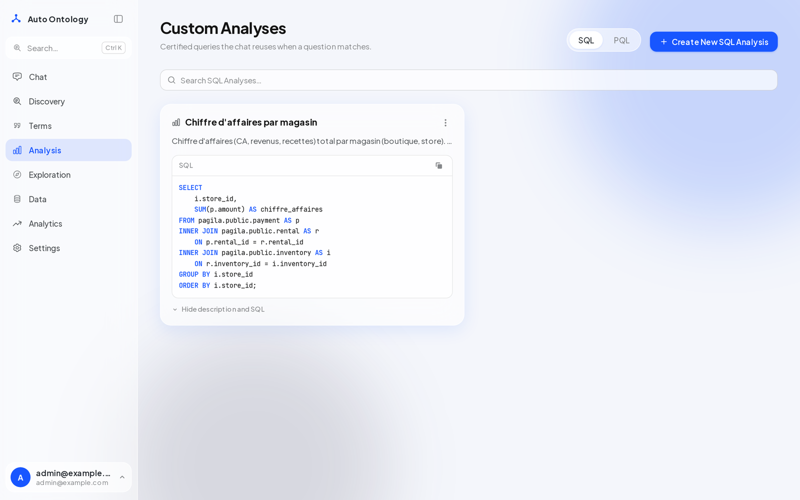
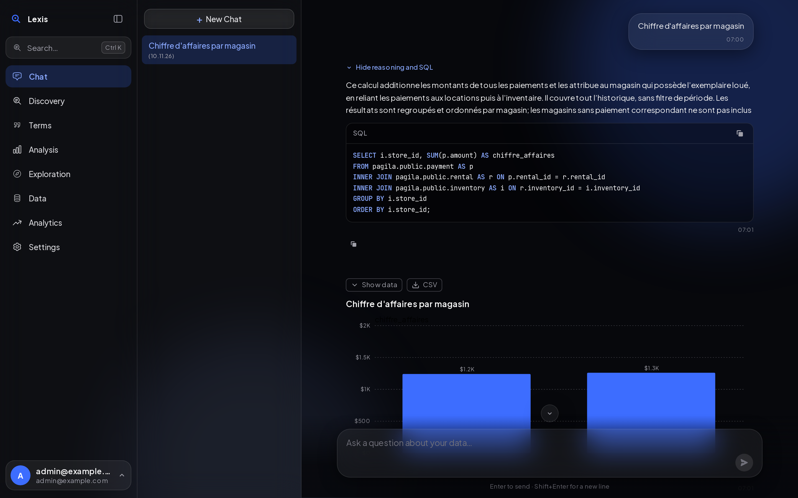
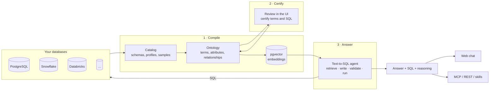

<!--
SPDX-FileCopyrightText: Copyright (c) 2026, NVIDIA CORPORATION & AFFILIATES.
SPDX-FileCopyrightText: Copyright (c) 2026, Julien Awonga.
SPDX-License-Identifier: Apache-2.0
-->

<div align="center">


# Lexis

### Ask your database anything, and get an answer you can check.

Lexis reads your schemas, builds a **business ontology** on top of them, and lets people and AI agents
query your data in plain language, with the SQL, the steps and the definitions behind every answer.

[](https://github.com/julienawonga/lexis/actions/workflows/ci-python.yml)
[](https://github.com/julienawonga/lexis/actions/workflows/ci-client.yml)
[](./LICENSE)
[](https://github.com/julienawonga/lexis/stargazers)
[](https://github.com/julienawonga/lexis/commits/main)
[](./CONTRIBUTING.md)


[**Quick start**](#-quick-start) · [**Features**](#-features) · [**Screenshots**](#-screenshots) ·
[**How it works**](#%EF%B8%8F-how-it-works) · [**Agents & MCP**](#-use-it-from-your-agent) ·
[**Roadmap**](#%EF%B8%8F-roadmap) · [**Docs**](#-documentation)

<br>



</div>

---

## 💡 Why Lexis?

Text-to-SQL demos look great until the number is wrong. A revenue figure answered in two seconds is worth nothing if
nobody can tell **which tables it joined, which definition of "revenue" it used, or whether that definition is the
one finance agreed on**.

Lexis puts a **semantic layer** between your questions and your databases:

- 🧠 **It understands your data.** It profiles every table and column, then compiles business **Terms**
  (*Customer*, *Payment*, *Store*), their attributes and their relationships into an ontology stored next to your
  catalog.
- 🔍 **It shows its work.** Every answer comes with the generated SQL, the reasoning, and the terms it resolved,
  so anyone can verify it in one click.
- ✅ **It learns your definitions.** Save a certified query once ("revenue per store = payments → rentals →
  inventory store") and the agent reuses it every time someone asks a similar question.
- 🤖 **It speaks to your agents.** The same ontology is served over **MCP**, a **REST API** and agent skills, so
  Claude, Cursor or your own agents query your data with the same trusted context.

Bring **any OpenAI-compatible model** (OpenAI, Azure, a LiteLLM gateway, Ollama, vLLM…) and **any of ten SQL
engines**. Everything runs on your own infrastructure with one `docker compose up`.

## ✨ Features

| | |
|---|---|
| 💬 **Chat with your data** | Ask in plain language, in any language. Answers stream in with a chart or a table, the SQL and the reasoning folded behind a toggle, copy buttons and CSV export. |
| 🧩 **Auto-built ontology** | Semantic compilation turns raw schemas into Terms, column attributes, SQL attributes and relationships, with embeddings in pgvector for retrieval. |
| 🕸️ **Ontology explorer** | An interactive graph of terms and data objects. Double-click a term to expand it into its tables, columns and attributes. |
| ✅ **Certified analyses** | Store reference SQL for key business questions. They become suggestions in the chat and are reused by the agent. |
| 🔎 **Discovery** | Search every table, column, term and analysis at once (Ctrl+K from anywhere), filter, and tag results with rules. |
| 📊 **Analytics** | See every question asked, by whom, through which channel, how long it took, and the SQL it produced. |
| 🛡️ **Governance** | Users, groups, roles (admin/viewer), zones, tags, a certification workflow, PII detection, SSO and API tokens. |
| 🔌 **Bring your own model** | Any OpenAI-compatible endpoint for chat, embeddings and reranking, configured with a few environment variables. |
| 🎨 **Modern UI** | A glass design with light and dark themes, a collapsible sidebar and keyboard shortcuts. |
| 🐳 **Self-hosted** | Docker Compose for a laptop, a Helm chart for Kubernetes. Your data never leaves your infrastructure. |

## 📸 Screenshots

<table>
  <tr>
    <td width="50%"><p align="center"><b>Chat</b>: answer, SQL and chart</p></td>
    <td width="50%"><p align="center"><b>Terms</b>: the ontology, term by term</p></td>
  </tr>
  <tr>
    <td width="50%"><p align="center"><b>Exploration</b>: the ontology as a graph</p></td>
    <td width="50%"><p align="center"><b>Analytics</b>: every question, audited</p></td>
  </tr>
  <tr>
    <td width="50%"><p align="center"><b>Analysis</b>: certified business queries</p></td>
    <td width="50%"><p align="center"><b>Dark theme</b></p></td>
  </tr>
</table>

## 🚀 Quick start

You need **Docker** (with Compose v2) and an API key for any **OpenAI-compatible** model endpoint. This walkthrough
uses **Pagila**, a sample DVD-rental database that ships with the repository.

**1. Clone and configure**

```bash
git clone https://github.com/julienawonga/lexis.git auto-ontology && cd auto-ontology
cp .env.example .env
```

Edit `.env` and set at least:

```dotenv
DEFAULT_MODELS_ENDPOINT=https://your-endpoint/v1      # any OpenAI-compatible endpoint
DEFAULT_MODELS_API_KEY=sk-...
DEFAULT_MODELS_MODEL=openai/gpt-4.1                   # any OpenAI-compatible model name
EMBED_MODEL=text-embedding-3-small
EMBED_DIMENSIONS=1536                                 # the output width of your embedding model
EMBED_EXTRA_FIELDS=false
AUTH_SECRET=<output of: openssl rand -base64 32>
POSTGRES_PASSWORD=<a new password>
AUTO_ONTOLOGY_ADMIN_PASSWORD=<a new password>
```

**2. Start the stack and load the sample data**

```bash
docker compose up -d --wait postgres
docker exec -i postgres psql -U postgres -c "CREATE DATABASE pagila;"
docker exec -i postgres psql -U postgres -d pagila < dev_tools/fixtures/sql/pagila.sql
docker compose up -d --build
```

**3. Connect, compile, ask**

1. Open <http://localhost:3000> and sign in with `AUTO_ONTOLOGY_ADMIN_EMAIL` / `AUTO_ONTOLOGY_ADMIN_PASSWORD`.
2. **Settings → Connections**: add PostgreSQL, host `postgres`, database `pagila`, and tick **Exclude Views**.
3. **Settings → Semantic Compilation**: turn it on and wait for *Semantic compilation is ready*.
4. Ask in **Chat**: *"What is the revenue per store?"* or *"Which 5 films made the most money?"*

> [!TIP]
> Open **Show reasoning and SQL** under an answer to see exactly how it was computed. Then save it under
> **Analysis** to make it the reference definition for everyone.

Kubernetes users: see [DEPLOYMENT.md](./DEPLOYMENT.md) for the Helm chart. Model and embedding settings are in
[docs/configuration.md](./docs/configuration.md).

## 🔌 Works with

**Databases**: PostgreSQL · MySQL · Snowflake · Databricks · ClickHouse · Trino · Apache Kyuubi · HeavyDB ·
DuckDB · SQLite ([connection guide](./docs/connections.md))

**Models**: anything that speaks the OpenAI API, such as OpenAI, Azure OpenAI, LiteLLM, Ollama, vLLM or
LM Studio ([model configuration](./docs/configuration.md))

**Agents**: Claude Desktop · Claude Code · Cursor · any MCP client · REST · agent skills

**Semantic models**: import and export with [Apache Ossie](https://ossie.apache.org/), the open standard for
semantic models (**Settings → Import / Export**).

## 🏗️ How it works



1. **Compile.** The ingestion service extracts schemas, profiles columns and samples values, then an LLM names the
   business entities, maps them to columns and infers how tables join.
2. **Certify.** People review terms, descriptions and SQL attributes in the UI and certify the ones that are right.
3. **Answer.** For each question, the agent extracts entities, retrieves candidate terms and columns by embedding
   search, writes SQL, checks filter values and the query against the database (repairing it when a check fails),
   runs it, and returns the answer with its SQL and the steps it took. When the ontology cannot support a question,
   it says so instead of guessing.

| Component | Stack | Port |
|---|---|---|
| Web app | Next.js 16, React 19, Tailwind CSS 4, Better Auth, Prisma, assistant-ui | 3000 |
| API | FastAPI (Python 3.12), LangChain | 3001 |
| Ingestion and compilation | FastAPI (Python 3.12) | 3002 |
| MCP server | FastMCP | 3003 |
| Storage | PostgreSQL 17 + pgvector | 5432 |

> [!IMPORTANT]
> Keep ports 3001 and 3002 on a private network: the API trusts the user identity the web app forwards, and the
> ingestion service has no authentication of its own. Clients go through the web app on port 3000.

## 🤖 Use it from your agent

**MCP.** Any MCP client gets read-only tools over the ontology (`search_terms`, `get_term`,
`check_answerable`, `ask_question`…), with each user's own permissions.

```json
{
  "mcpServers": {
    "auto-ontology": { "url": "http://localhost:3003/mcp" }
  }
}
```

**REST.** Create an API token from the account menu, then stream an answer:

```bash
curl -N http://localhost:3000/api/chat/completions \
  -H "x-api-key: $AUTO_ONTOLOGY_API_TOKEN" \
  -H "Content-Type: application/json" \
  -d '{"question": "What is the revenue per store?"}'
```

**Agent skills.** Three skills teach a coding agent to set up, manage and query an ontology; start at
[AGENTS.md](./AGENTS.md). Details: [docs/mcp.md](./docs/mcp.md) · [docs/conversation-api.md](./docs/conversation-api.md).

## 🗺️ Roadmap

- [x] Any OpenAI-compatible model provider
- [x] Glass UI with light and dark themes, sidebar with Ctrl+K search
- [x] Chat with folded reasoning and SQL, copy, suggestions from certified analyses
- [x] Docker Official Images, digest-pinned
- [x] Foreign keys declared on partitioned tables, and composite keys (Postgres)
- [x] Agent SQL is read-only and row-capped, enforced by the database on five engines
- [x] Evaluation harness for the text-to-SQL engine
- [x] Rebuild and health check of the semantic index
- [x] Held-out evaluation set on a second database (Chinook)
- [ ] Provenance and review status on ontology facts; never overwrite a human edit
- [ ] Business metrics as verified, reusable definitions
- [ ] Matching question values to stored values
- [ ] Clarification questions in chat
- [ ] Key-figure tiles on database pages
- [ ] Interface translations (French first)
- [ ] One-click deploy templates (Railway, Render)
- [ ] Replace the remaining vendor UI components with open ones

Have an idea? [Open an issue](https://github.com/julienawonga/lexis/issues/new): feature requests and
feedback shape the roadmap.

## 🤝 Contributing

Contributions are welcome, from typo fixes to new connectors. Read [CONTRIBUTING.md](./CONTRIBUTING.md), then open
a pull request: CI runs Ruff, pytest, Prettier, ESLint, the frontend build and the OpenAPI checks on every PR.

If Lexis is useful to you, **a ⭐ on the repository helps others find it.**

## 📚 Documentation

| Topic | Doc |
|---|---|
| Models, embeddings and environment variables | [docs/configuration.md](./docs/configuration.md) |
| Connections, scoping and Vault | [docs/connections.md](./docs/connections.md) |
| Authentication, SSO and API tokens | [docs/authentication.md](./docs/authentication.md) |
| Conversation API | [docs/conversation-api.md](./docs/conversation-api.md) |
| Safety of agent-issued SQL | [docs/query-safety.md](./docs/query-safety.md) |
| Evaluating the text-to-SQL engine | [docs/evaluation.md](./docs/evaluation.md) |
| MCP server | [docs/mcp.md](./docs/mcp.md) |
| Kubernetes with Helm | [DEPLOYMENT.md](./DEPLOYMENT.md) |
| REST API (OpenAPI) | [docs/openapi/auto-ontology-api.json](./docs/openapi/auto-ontology-api.json) |
| What this fork changed | [FORK.md](./FORK.md) |

## ⭐ Star history

<a href="https://star-history.com/#julienawonga/lexis&Date">
  
</a>

## 📄 License and credits

Lexis is licensed under the [Apache License 2.0](./LICENSE). It started as a fork of
[NVIDIA/auto-ontology](https://github.com/NVIDIA/auto-ontology); files from the original project keep their
copyright headers, as the license requires. Third-party components are listed in
[THIRD_PARTY_NOTICES.md](./THIRD_PARTY_NOTICES.md) and
[CONTAINER_THIRD_PARTY_NOTICES.md](./CONTAINER_THIRD_PARTY_NOTICES.md).

This software calls the model endpoints you configure, the optional KumoRFM service when `KUMO_RFM_API_KEY` is set,
and your own databases, each under its own terms. It is provided "as is", without warranty of any kind. Report
security issues as described in [SECURITY.md](./SECURITY.md).
