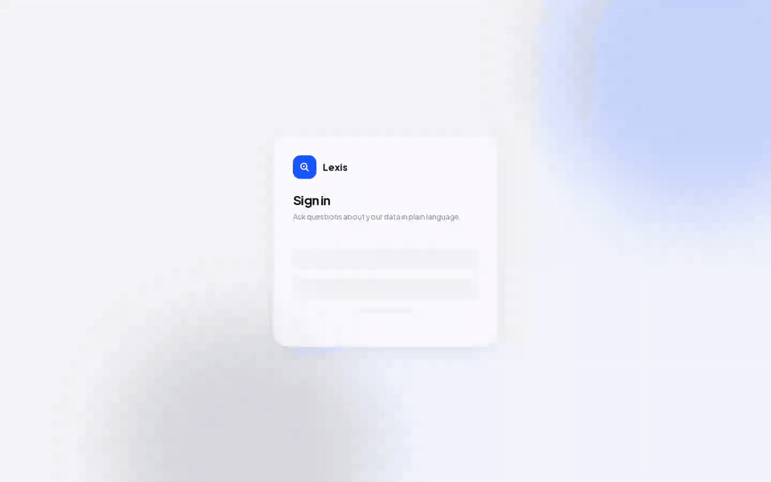

# Lexis

Lexis reads your schemas, builds a **business ontology** on top of them, and lets people and AI agents query your data in plain language, with the SQL, the steps and the definitions behind every answer.



## Features

- Chat with your data in plain language and inspect the SQL and reasoning behind an answer.
- Build an ontology of business terms, attributes, and relationships from database schemas.
- Explore terms and data objects in an interactive graph.
- Save certified queries for key business questions and reuse them in chat.
- Search tables, columns, terms, and analyses.
- Review question activity and the SQL it produced in analytics.
- Connect agents through MCP, REST, and agent skills.

## Start with Docker Compose

The README walkthrough uses Docker Compose and the Pagila sample database. Clone the repository, configure `.env` from `.env.example`, then start the stack:

```bash
docker compose up -d --wait postgres
docker exec -i postgres psql -U postgres -c "CREATE DATABASE pagila;"
docker exec -i postgres psql -U postgres -d pagila < dev_tools/fixtures/sql/pagila.sql
docker compose up -d --build
```

## Documentation

- [Configuration](configuration.md)
- [Connections and credential storage](connections.md)
- [Source-database connections](source-connections.md)
- [Authentication, SSO, and API tokens](authentication.md)
- [API reference](api/)
